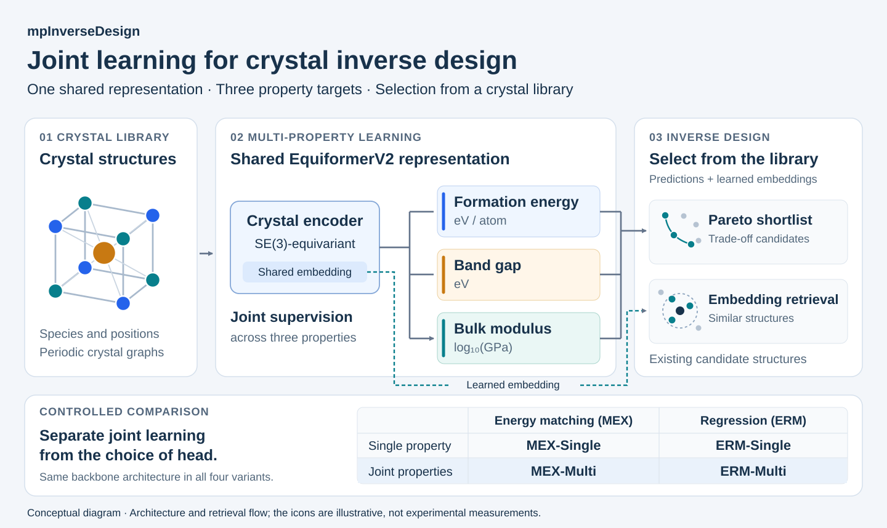

# Inverse Design of Crystalline Materials via Joint Multi-Property Training

**Authors:** Dipannoy Das Gupta, Ram Linga Reddy Chevva, Sourin Dey, Sadman Sadeed Omee, Ying Feng, Liang Tao, Hossein Erfanshekooh, and Jianjun Hu.

**Affiliation:** Department of Computer Science, University of South Carolina, Columbia, South Carolina, USA.

**Laboratory:** [Machine Learning and Evolution Laboratory (MLEG)](http://mleg.cse.sc.edu).



*Joint training connects formation energy, band gap, and bulk modulus through a shared crystal representation. Property predictions support Pareto selection, while learned embeddings support retrieval of similar structures from an existing library. The diagram is schematic.*

Code, data identifiers, and results for the paper. The study asks whether training
one model on several properties at once helps recover a **trade-off surface** —
the set of crystals that cannot be improved on one property without giving up
another — from an existing candidate library.

Each target gets its own prediction head on top of a single shared
SE(3)-equivariant **EquiformerV2** backbone, so properties are coupled only
through gradients into the shared network. Two heads are compared: an
**energy-based matching head** (MEX), scored over (structure, candidate value)
pairs and read out by a derivative-free optimizer, and an ordinary
**regression head** (ERM). Crossing single- vs multi-property training with the
two heads gives a 2x2 design.

| | energy head | regression head |
|---|---|---|
| one property at a time | `MEX-Single` | `ERM-Single` |
| all three jointly | `MEX-Multi` | `ERM-Multi` |

Targets: formation energy (eV/atom), band gap (eV), and Voigt–Reuss–Hill bulk
modulus (log10 GPa).

## What the paper finds

- **Accuracy:** joint training improves only band-gap accuracy; formation
  energy and bulk modulus are unchanged.
- **Pareto recovery:** joint training raises recall under the all-minimization
  reference objective with both heads, but the gain does not hold under three
  alternative objective directions.
- **Retrieval:** only the jointly trained embeddings are informative about all
  three properties at once. Each single-property embedding is strong on its own
  target and markedly weaker on the other two.

## Repository layout

```
configs/                   one config per model variant
  mex-single/                MEX-Single   (energy head, one property at a time)
  mex-multi/                 MEX-Multi    (energy head, three properties jointly)
  erm-single/                ERM-Single   (regression head, one property)
  erm-multi/                 ERM-Multi    (regression head, three properties)
  heldout/                   predict-only overlays for the held-out library
code/                      training and evaluation code (see "Attribution")
  ocp/main.py                entry point for --mode train / --mode predict
  ocp/ocpmodels/trainers/    mex_trainer.py, mex_multi_trainer.py,
                             ocp_trainer.py, ocp_multi_trainer.py
  compute_res_metric.py              MAE / Spearman / EGM, single-property run
  compute_multi_res_metric.py        ... multi-property run
  compare_pareto_erm_vs_mex.py       Pareto fronts, IGD+, hypervolume
  inverse_design/            embedding and nearest-neighbour retrieval
data/
  mp20_5k/cifs.json         all 5,000 CIFs in one JSON bundle
  mp20_5k/{train,val,test}/  labels for the exact 4,500 / 250 / 250 split
  labels/                    all material identifiers and labels (see "Data")
scripts/
  extract_cifs.py             restore the separate CIFs from cifs.json
  build_lmdb/                build the LMDB datasets (run these first)
  eval/                      Pareto re-scoring and the random-retrieval baseline
docs/
  VALIDATION_BUG.md          why mex_trainer.py differs from upstream
```

## Environment

One CUDA GPU with >= 16 GB is enough; the published runs used a V100 (16 GB).
`torch` and the PyG companions need their own index URLs, so install them first:

```bash
python3.11 -m venv ~/.venvs/mulproperties   # 3.10 or 3.11; both have wheels
source ~/.venvs/mulproperties/bin/activate
pip install --upgrade pip

# torch and the PyG companions come from their own indexes. The PyG builds are
# tagged pt24cu121 and must match torch 2.4.1+cu121.
# requirements.txt pins the whole dependency closure; install it first.
pip install -r requirements.txt

# torch and the PyG companions come from their own indexes. The PyG builds are
# tagged pt24cu121 and must match torch 2.4.1+cu121.
pip install -c requirements.txt --index-url https://download.pytorch.org/whl/cu121 torch==2.4.1
pip install -c requirements.txt -f https://data.pyg.org/whl/torch-2.4.0+cu121.html \
    torch_geometric==2.7.0 torch_scatter torch_sparse

python -c "import torch, torch_geometric, torch_scatter, e3nn, lmdb; \
print(torch.__version__, torch.cuda.is_available())"
```

`requirements.txt` is the full pinned closure of an environment that actually
ran these experiments, on a node with GCC 6.1, so every package resolves to a
wheel and nothing is compiled. The closure is pinned on purpose: several
packages the code needs are transitive dependencies that upstream leaves
unpinned — `scipy` via `torch_sparse`, `scikit-learn` via `denseweight` — and
letting pip choose picks a version with no compatible wheel, which it then
tries to build, pulling in a newer `numpy` as a build dependency and failing
on the compiler. Install `requirements.txt` before torch, and keep it as a
constraint on the torch and PyG steps. Also keep the `ptXXcuYYY` tag matched
to the torch version, or the PyG imports fail at run time.

On a cluster, run the installation commands above in an allocated compute
session rather than on a login node.

On a cluster, point `TMPDIR` at a large filesystem before installing. The CUDA
wheels unpack to several GB, and a login node's `/tmp` is often too small —
a 2 GB `/tmp` fails with `OSError: [Errno 28] No space left on device`:

```bash
export TMPDIR=/path/to/scratch/tmp PIP_CACHE_DIR=/path/to/scratch/pipcache
mkdir -p "$TMPDIR" "$PIP_CACHE_DIR"
```

`docs/environment_freeze.txt` is the exact frozen environment of the published
runs. Every shipped config logs to **tensorboard**, so no Weights & Biases
account is required.

## Data

Two things are shipped, and one has to be downloaded.

**Shipped — all 5,000 CIFs in one JSON file.**
[`data/mp20_5k/cifs.json`](data/mp20_5k/cifs.json) contains the original CIF
text, relative filename, and SHA-256 checksum for every structure. The
train/validation/test split remains exactly **4,500 / 250 / 250**.
Separate `labels.csv` files remain in `data/mp20_5k/{train,val,test}/`
(`material_id, split, formation_energy_per_atom, band_gap, bulk_modulus,
cif_sha256, ...`), so the split is reproducible exactly rather than by reseeding.

After cloning, restore the separate CIF files with the provided script:

```bash
git clone https://github.com/usccolumbia/mpInverseDesign.git
cd mpInverseDesign
python3 scripts/extract_cifs.py
```

This requires only Python's standard library. It writes the original
`train/*.cif`, `val/*.cif`, and `test/*.cif` paths under `data/mp20_5k/`,
preserving every CIF byte and checking its checksum. Identical existing files
are skipped; different existing files are not overwritten. Restored CIFs are
gitignored. To check the JSON without extracting anything, run
`python3 scripts/extract_cifs.py --verify-only`; to use another destination,
add `--output-dir /path/to/mp20_5k`.

`data/labels/` holds:

| file | rows | what |
|---|---|---|
| `mp20_labels.csv` | 45,229 | every MP20 material: formation energy, band gap, and bulk modulus where known |
| `mp20_bulk_modulus.csv` | 9,803 | the bulk-modulus subset (`k_vrh_gpa`, `k_vrh_log10`) |
| `mp20_5k_{train,val,test}_ids.csv` | 4,500 / 250 / 250 | the training split |
| `heldout_library.csv` | 4,803 | held-out library: three-property pool minus mp20_5k, with a
  `k_vrh_physical` flag |
| `heldout_library_kphys.csv` | 4,773 | the same library with the 30 non-physical bulk moduli removed |
| `retrieval_pool.csv` | 38,804 | retrieval pool with its labels |

**You must build the LMDBs before training.** The trainers read LMDB datasets,
not CIFs (`format: lmdb`, `src: data/mp20_5k/train`), and the built datasets are
~1.2 GB in total, too large to host here. Building them needs the MP20 table
*with CIF strings*, which is also too large to host. So:

1. Get MP20 and alex_mp20 from the
   [MatterGen](https://github.com/microsoft/mattergen) release (both derive from
   the [Materials Project](https://materialsproject.org)) and place them as:

   | file | size | needed by |
   |---|---|---|
   | `data/all_with_180.csv` | ~134 MB | the LMDB builders, and `--all-csv` in retrieval |
   | `data/alex_mp20_train.csv` | ~790 MB | `--alex-train` in retrieval (step 4) |
   | `data/alex_mp20_val.csv` | ~87 MB | `--alex-val` in retrieval (step 4) |

   Only `all_with_180.csv` is needed to train; the two alex tables are read when
   building the retrieval pool's embeddings.
2. Build, **from the repository root**, in this order — each step consumes the
   previous one's output:

```bash
cd $(git rev-parse --show-toplevel)
python scripts/build_lmdb/build_mp20_three_property_lmdb.py   # -> data/mp20_three_property  (9,803)
python scripts/build_lmdb/build_small_datasets.py             # -> data/mp20_5k              (4,500/250/250)
python scripts/build_lmdb/build_single_property_lmdbs.py      # -> data/mp20_5k_{eform,bandgap,gvrh}
python scripts/build_lmdb/build_heldout_lmdb.py               # -> data/mp20_heldout{,_eform,_bandgap,_gvrh}
```

`data/labels/mp20_bulk_modulus.csv` is already shipped, so `download_bulk_modulus.py`
is only needed if you want to regenerate it from scratch. The builders also
print or write config blocks; ignore them, since `configs/` is already correct.

The LMDBs land *beside* the restored CIFs — `data/mp20_5k/train/` ends up holding
both `data.lmdb` and the 4,500 `.cif` files. Nothing is overwritten, and the CIFs
let you verify what went into each split. Paths in the configs are relative to
the repository root, which is why every command is run from there. All generated
LMDBs are gitignored.

Graphs are built with a 12 A cutoff and at most 20 neighbours. Sanity check: the
three-property pool must come out at **9,803** structures, the held-out library at
**4,803** (**4,773** after the bulk-modulus filter), and the retrieval pool at
**38,804** (of which 33,146 carry formation energy and 3,114 a bulk modulus).
`data/labels/retrieval_pool_audit.json` and `heldout_library_audit.json` record
those counts.

## Running the experiments

**Run every command from the repository root.** The configs resolve `configs/...`
and `data/...` relative to the working directory, so nothing needs to be copied
or symlinked. **Build the LMDBs first** — see "Data" above; training fails
immediately without them. Every run takes `--seed`; the paper averages seeds 0, 1, 2.

### 1. Training

| Variant | Config |
|---|---|
| `MEX-Multi` | `configs/mex-multi/mp20_5k_multi.yml` |
| `ERM-Multi` | `configs/erm-multi/mp20_5k_multi.yml` |
| `MEX-Single` | `configs/mex-single/mp20_5k_{eform,bandgap,gvrh}.yml` |
| `ERM-Single` | `configs/erm-single/mp20_5k_{eform,bandgap,gvrh}.yml` |

MEX-Multi applies local NCE to all three targets plus the 0.25-weighted
Euclidean term.

```bash
# MEX-Multi, seed 0
python code/ocp/main.py --mode train \
    --config-yml configs/mex-multi/mp20_5k_multi.yml \
    --run-dir runs/mex_multi_seed0 --seed 0 --amp --num-gpus 1 \
    --identifier mex_multi_seed0

# MEX-Single, bulk modulus, seed 0
python code/ocp/main.py --mode train \
    --config-yml configs/mex-single/mp20_5k_gvrh.yml \
    --run-dir runs/mex_single_gvrh_seed0 --seed 0 --amp --num-gpus 1 \
    --identifier mex_single_gvrh_seed0
```

Shared settings, already in the configs: batch size 64, AdamW, EMA 0.999,
gradient clipping at 10, ReduceLROnPlateau (factor 0.8), early stopping after 30
evaluations without improvement, 750-epoch cap. Energy heads use 500 NCE
negatives per structure from a three-component Gaussian mixture
(sigma = 0.075, 0.15, 0.3 in normalized units) and read out with a
derivative-free optimizer (S = 2000 candidates, T = 5 iterations, initial noise
0.5 halved each iteration, bounds = normalized training extremes +/- 2).

> **Use this repository's `mex_trainer.py`, not an upstream checkout.** The
> single-property validation metric in the original code was broken; the fix
> is described in `docs/VALIDATION_BUG.md` and is already applied here.

### 2. Prediction and accuracy

```bash
CKPT=$(find runs/mex_multi_seed0/checkpoints -name best_checkpoint.pt | head -1)

# 250-structure test split
python code/ocp/main.py --mode predict --config-yml configs/mex-multi/mp20_5k_multi.yml \
    --checkpoint "$CKPT" --run-dir runs/mex_multi_seed0/results_test --amp --num-gpus 1
# 4,803-structure held-out library
python code/ocp/main.py --mode predict --config-yml configs/heldout/mex_multi.yml \
    --checkpoint "$CKPT" --run-dir runs/mex_multi_seed0/results_heldout --amp --num-gpus 1

# predict writes into a timestamped subdirectory, so pick the newest file
PRED=$(find runs/mex_multi_seed0/results_test -name '*_predictions.npz' \
       -printf '%T@ %p\n' | sort -n | tail -1 | cut -d' ' -f2-)
python code/compute_multi_res_metric.py \
    --pred-file "$PRED" \
    --out-csv   runs/mex_multi_seed0/results_test/metrics.csv
```

Use `compute_res_metric.py` for single-property runs and the `configs/heldout/*`
counterpart matching the variant.

### 3. Pareto-front recovery

Each variant assigns a predicted property vector to every library structure;
NSGA-II fast non-dominated sorting extracts the predicted front, which is then
compared against the front obtained from the measured DFT values. Structures
whose measured bulk modulus falls outside [1, 600] GPa are dropped from the
library first (4,803 -> 4,773: 7 below 1 GPa and 23 above 600 GPa, the largest
1.8e10 GPa), because non-physical entries can occupy the true front and compress
the rescaling used by IGD+ and hypervolume. The accuracy tables use all 4,803
structures; only the Pareto evaluation filters. `data/labels/heldout_library.csv`
carries a `k_vrh_physical` flag and `heldout_library_kphys.csv` is the filtered
subset, with the counts recorded in `heldout_library_audit.json`.

```bash
bash scripts/eval/run_pareto.sh      # all four objective conventions
```

Writes `pareto_per_seed.csv`, `SUMMARY.md`, and `library_filter_audit.json`.
Conventions, in the order (E_form, E_g, K_VRH): the reference
`(min, min, min)`, plus `(min, |E_g - 1.4|, max)`, `(min, max, max)`, and
`(min, min, max)`. Hypervolume uses reference point 1.1 in every rescaled
objective.

### 4. Embedding-space retrieval

For each of the 250 test queries, retrieve the `k = 10` nearest pool structures
by cosine similarity (pooled over 3 seeds, so 30 neighbours) and compare the
query's measured property against the mean over its neighbours.

Two steps: embed the queries and the pool once per trained run, then score.

```bash
# (a) embeddings + nearest neighbours, one trained run at a time
CKPT=$(find runs/mex_multi_seed0/checkpoints -name best_checkpoint.pt | head -1)
python code/inverse_design/embed_and_match_alex_v3.py \
    --checkpoint "$CKPT" --config configs/mex-multi/mp20_5k_multi.yml \
    --test-lmdb  data/mp20_5k/test/data.lmdb \
    --train-lmdb data/mp20_5k/train/data.lmdb \
    --val-lmdb   data/mp20_5k/val/data.lmdb \
    --all-csv    data/all_with_180.csv \
    --out-dir    runs/mex_multi_seed0/alex_match \
    --top-k 10 --batch-size 16 --device cuda

# (b) per-query scoring, pooling the three seeds of each variant
seeds() { echo runs/$1_seed{0,1,2}/alex_match | tr ' ' ,; }
python code/inverse_design/retrieval_per_query.py --arm mex \
    --test-lmdb data/mp20_5k/test/data.lmdb \
    --single-eform-dirs   "$(seeds mex_single_eform)" \
    --single-bandgap-dirs "$(seeds mex_single_bandgap)" \
    --single-gvrh-dirs    "$(seeds mex_single_gvrh)" \
    --multi-dirs          "$(seeds mex_multi)" \
    --bootstrap 2000 --out-dir results/retrieval_mex
```

Each `--*-dirs` flag takes one comma-separated list; the `seeds` helper builds
it. Use `--arm erm` with the ERM runs.
Leave `--k` unset: the default uses every neighbour in the match file, which is
the 10-per-seed x 3 seeds = 30 the paper reports. Single-property runs are
embedded with `embed_and_match_alex_single.py`, same arguments plus `--prop`.

The random baseline is a null distribution, not a single draw: each of 2,000
independent draws gives every query its own 30 uniformly sampled structures and
yields one MAE and one Spearman, and the table reports the mean with 2.5/97.5
percentiles across draws.

```bash
python scripts/eval/random_retrieval_multidraw.py \
    --pool-csv data/labels/retrieval_pool.csv \
    --labels-dir data/mp20_5k \
    --k 30 --draws 2000 --out results/retrieval_random/rerun.json
```

## A bug worth knowing about

`docs/VALIDATION_BUG.md` documents a shape-broadcasting error in the original
single-property MEX trainer. Its validation MAE compared predictions of shape
`(B,)` against targets of shape `(B, 1)`, which NumPy/torch broadcast to a
`B x B` matrix, so the reported "MAE" was the mean error over **every pair** of
structures in the batch. That quantity is minimized by predicting the label
median, and because checkpoint selection, the learning-rate schedule, and early
stopping all consumed it, single-property models were driven toward nearly
constant predictions. The training loss was never affected, and the
multi-property trainer, which reshapes to `(B, 1)`, was never affected.

The fix is one line, already applied in `code/ocp/ocpmodels/trainers/mex_trainer.py`:

```python
return {target_name: y_pred.view(-1, 1)}
```

## Attribution

`code/ocp/` derives from [fairchem](https://github.com/FAIR-Chem/fairchem) (MIT).
The energy head, NCE objective, and derivative-free read-out come from
[MEX](https://github.com/panmianzhi/Matching-based-EXtrapolation); this work adds
the multi-property trainer, the Pareto and retrieval evaluations, and the
validation fix above. Data derive from the MP20 and alex_mp20 releases of
MatterGen, based on the Materials Project. See `LICENSE`.

## Citation

```bibtex
@article{dasgupta2026mulproperties,
  title  = {Inverse Design of Crystalline Materials via Joint Multi-Property Training},
  author = {Das Gupta, Dipannoy and Chevva, Ram Linga Reddy and Dey, Sourin and
            Omee, Sadman Sadeed and Feng, Ying and Tao, Liang and
            Erfanshekooh, Hossein and Hu, Jianjun},
  year   = {2026}
}
```
